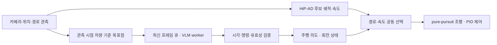

# VLM-Guided Planner Intervention

**VLM이 장면을 판단하고, 검증된 주행 계획기가 운전한다.**
기존 End-to-End 주행 모델(HiP-AD)이 멈추거나 잘못 판단하는 예외 상황에서,
Vision-Language Model이 고수준 주행 의도를 비동기로 제시하고 계획기가 이를
후보 궤적 선택에 반영하는 Trajectory Gating 구조입니다.

> 🏆 **2026 MIDAS CDP 경진대회 최우수상** · 3인 팀 팀장 프로젝트
> CARLA 0.9.15 · Bench2Drive · HiP-AD · Qwen2.5-VL 7B (파인튜닝)

## 핵심 결과

같은 코드·같은 시뮬레이터 설정에서 HiP-AD 단독과 VLM 결합을 짝지어 비교했습니다.

| 상황 | 경로 | HiP-AD 단독 | VLM 결합 |
|---|---|---|---|
| 열린 차량 문 | 25928 | 54점 | **100점 완주** |
| 열린 차량 문 | 3464 | 30점 | **100점 완주** |
| 막힌 교차로 | 27532 | 5회 모두 정지 | **3회 모두 경로 완주** |

결합 시스템은 출차, 막힌 교차로, 주차 차량 사이 보행자, 열린 차량 문 네 가지
대회 시나리오를 모두 완주했습니다.
→ [10월 짝 비교 재검증](docs/paired-validation-2026-10.md) ·
[비동기 검증 기록](docs/async-validation.md) ·
[경로·속도·제어 검증](docs/grounded-control-validation.md)

## 설계 원칙

| 원칙 | 구현 |
|---|---|
| **VLM은 의도만, 운전은 계획기가** | VLM은 `change_lane_left`, `lane_follow`, `stop` 같은 고수준 명령 하나만 출력합니다. 연속 궤적과 조향·가속은 HiP-AD와 제어기가 담당합니다. |
| **주행은 VLM을 기다리지 않는다** | 크기 1 큐로 최신 프레임만 VLM에 넘기고, 제어 루프는 응답 없이도 계속 돕니다. |
| **검증을 통과한 판단만 반영** | 결과의 원본 시각·유효 기간(TTL)·경로 일치를 검사하고, 통과하지 못하면 기존 계획기 동작으로 돌아갑니다. |
| **관측과 좌표의 시점 일치** | 카메라와 목표점을 같은 관측 시점의 차량 기준 좌표(x=전방, y=우측)로 묶어 VLM에 전달합니다. |



1. **입력 시점 맞추기:** 목표점에서 관측 당시 차량 위치를 빼고 전방·우측 축에 투영합니다.
2. **비동기 추론:** 최신 관측만 유지하는 큐와 TTL로, 늦게 도착한 오래된 판단은 버립니다.
3. **의도와 실행 상태 연결:** 회전 명령은 관측 시점의 경로 출구를 기억하고, 현재
   위치·방향으로 완료를 확인합니다. 정지 명령은 우선합니다.
4. **경로·속도 공동 선택:** 실제 조향에 쓸 경로와 속도 후보를 함께 놓고 경로 기하와
   예측 장애물을 검사해 고릅니다.
5. **검사한 계획을 그대로 실행:** 후보 운동 예측과 실제 조향에 같은 pure-pursuit 계산을 씁니다.

단계별 책임은 [설계 문서](docs/concept.md)에 정리했습니다.

## 참조 코드

`src/vlm_async_gate/`에 좌표 변환과 비동기 런타임의 독립 참조 구현이 있습니다.

```python
from vlm_async_gate import FrameSample, capture_navigation

navigation = capture_navigation(
    frame_id=10, simulation_time_s=1.0,
    position_xy=(100, 200),
    forward_xy=(0, -1), right_xy=(1, 0),
    near_target_xy=(102, 190), far_target_xy=(97, 180),
)
assert navigation.near_forward_right == (10.0, 2.0)
payload = {"navigation": navigation, "prompt_fields": navigation.prompt_values()}
sample = FrameSample(navigation.frame_id, navigation.simulation_time_s, payload)
# 실제 제출 시 payload에 같은 관측 시점의 카메라 입력을 함께 넣는다.
# worker.submit(sample)
```

```bash
PYTHONPATH=src python3 -m unittest discover -s tests -v
```

- [좌표 계약과 예제](docs/capture-coordinates.md) · [비동기 시간 계약](docs/async-runtime.md)
- 코드: `src/vlm_async_gate/coordinates.py`, `src/vlm_async_gate/runtime.py`

## 문서

| 문서 | 내용 |
|---|---|
| [concept.md](docs/concept.md) | 전체 구조와 단계별 책임 |
| [paired-validation-2026-10.md](docs/paired-validation-2026-10.md) | 같은 조건 단독 vs VLM 결합 짝 비교 |
| [async-validation.md](docs/async-validation.md) | 비동기 개입과 열린 차량 문 회피 검증 |
| [grounded-control-validation.md](docs/grounded-control-validation.md) | 경로·속도·조향 구성 검증 (27532 충돌 0, 100점) |
| [verified-prototype.md](docs/verified-prototype.md) | 동기식 초기 프로토타입 기록 |

## 평가 범위

- 결과는 선정 경로별 소수 실행이며, 데이터셋 전체 성공률을 뜻하지 않습니다.
- CARLA는 VLM 추론 중 시뮬레이션 시간을 멈출 수 있어, 실제 20Hz 실시간 동작은 별도 검증이 필요합니다.
- 경로 선택은 예측 장애물과 근사 운동 모델에 의존합니다.

## 공개 범위와 권리

이 저장소는 독립 참조 코드, 설계 설명, 집계 검증 기록만 포함합니다.
HiP-AD 등 제3자 소스·통합 패치, 모델 가중치, 데이터셋, 원본 로그와 영상은 포함하지 않습니다.
배경 계획기는 [HiP-AD](https://github.com/nullmax-vision/HiP-AD)이며, 본 저장소는 공식 프로젝트나
제휴 구현이 아닙니다. [제3자 자료 범위](THIRD_PARTY.md) · [권리 고지](RIGHTS.md) ·
[공개 체크리스트](docs/publication-checklist.md). 별도 오픈소스 라이선스는 부여하지 않습니다.

## English Summary

A Trajectory Gating architecture in which a fine-tuned Qwen2.5-VL 7B issues one high-level
driving intent asynchronously, and the HiP-AD planner keeps full control of trajectories and
low-level actuation. Intents are validated by source time, TTL and route consistency before they
affect target selection; otherwise the native planner runs unchanged. In paired CARLA runs under
identical settings, the integrated system completed open-door routes where HiP-AD alone scored
54 and 30 (both → 100), and a blocked-intersection route where HiP-AD alone stopped in all five
runs (VLM: 3/3 route completions). Winner of the 2026 MIDAS CDP competition (team lead).
